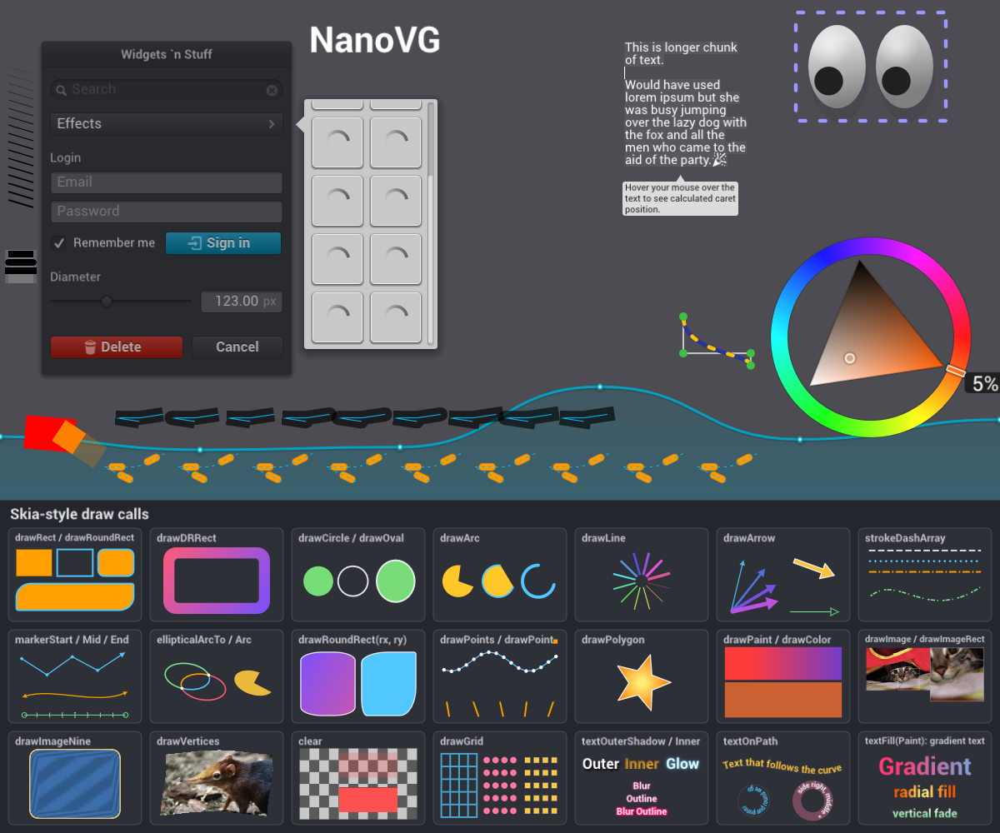

NanoVG++
==========

NanoVG++ is small antialiased vector graphics rendering library for OpenGL and Vulkan. It has lean API modeled after HTML5 canvas API. It is aimed to be a practical and fun toolset for building scalable user interfaces and visualizations.

This repository’s **`modernize-cpp`** branch extends upstream NanoVG with a C++20 implementation while keeping a stable C API that mirrors it for C programs and bindings. The notes below under **Changes since upstream** summarize what differs from the merge-base with [memononen/nanovg](https://github.com/memononen/nanovg) `master` (commit `6a8a2e7`).

## Changes since upstream

- **C++20 core** — Drawing logic lives under [`src/nvg/`](src/nvg/): [`nanovg.hpp`](src/nvg/nanovg.hpp) is the primary C++ API; implementation is split across `nanovg.cpp`, `nanovg_context.*`, `nanovg_detail.*`, and related translation units instead of a single `nanovg.c`.
- **Stable C API** — The `nvg*` entry points in [`nanovg.h`](src/nvg/stable/nanovg.h) are implemented in [`nanovg_stable.cpp`](src/nvg/nanovg_stable.cpp) on top of `nvg::Context` and mirror the C++ API, including the Skia-style draw calls (`nvgDrawRect`, `nvgClear`, …) and the Vulkan backend ([`nanovg_vk.h`](src/nvg/stable/nanovg_vk.h)). C headers live in [`src/nvg/stable/`](src/nvg/stable/) (`nanovg.h`, `nanovg_gl.h`, `nanovg_gl_utils.h`, `nanovg_vk.h`). See [Stable C API](#stable-c-api) below.
- **OpenGL backends** — C++ headers: [`nanovg_gl.hpp`](src/nvg/nanovg_gl.hpp), [`nanovg_gl_utils.hpp`](src/nvg/nanovg_gl_utils.hpp). The C API uses the `.h` variants in `stable/`.
- **Vulkan backend** — Header-only [`nanovg_vk.hpp`](src/nvg/nanovg_vk.hpp) (`nvg::createVk`), a port of the GL3 renderer including this fork's dashed/dotted/glow line styles. It resolves all Vulkan functions through the `vkGetInstanceProcAddr` you pass in, so it does not link against the Vulkan loader. Shaders live in [`src/nvg/shaders/`](src/nvg/shaders/) and are embedded as precompiled SPIR-V. See [Vulkan](#vulkan) below.
- **Skia-style draw calls** — `nvg::Context` adds one-call methods modeled after `SkCanvas` (`drawRect`, `drawRoundRect`, `drawArc`, `drawImageRect`, `drawImageNine`, `drawVertices`, …) plus the `Rect`, `PaintStyle` and `PointMode` types. See [Skia-style draw calls](#skia-style-draw-calls-c-only) below.
- **Third-party headers** — `fontstash.h`, `stb_truetype.h`, and the tree’s `stb_image.h` are under [`src/thirdParty/`](src/thirdParty/).
- **Build** — **CMake** is the supported route; **GLEW** is required via `find_package` or the `external/glew` submodule. **GLFW** is required for the stable C API examples (`example_stable_*`) and for C++ examples when SDL3 is not used (`external/glfw` submodule or system package). C++ example targets: `example_gl2`, `example_gl3`, `example_fbo`, **`example_vk`** (Vulkan). The stable C API equivalents are `example_stable_gl2`, `example_stable_gl3`, `example_stable_fbo`, **`example_stable_vk`**. The Vulkan targets, and the **`nanovg_vk`** library that implements the Vulkan C API, need only the Vulkan headers, taken from the pinned `external/Vulkan-Headers` submodule (never a system install), plus a Vulkan driver at runtime. Turn them off with `-DNANOVG_BUILD_VULKAN=OFF`.
- **SDL3 (optional)** — C++ examples can use **SDL3** instead of GLFW: `-DNANOVG_USE_SDL3=ON`, with SDL3 from `find_package(SDL3)` or the **`external/SDL`** git submodule. Window creation is wrapped in [`example/nvg_window_sdl3.cpp`](example/nvg_window_sdl3.cpp) / [`nvg_window_glfw.cpp`](example/nvg_window_glfw.cpp). CMake option **`NVG_FAST_SQRT`** toggles the fast inverse-sqrt path in the core (`NANOVG_FAST_SQRT`).
- **Example layout** — C++ sources and shared `demo.cpp` / `perf.cpp` stay in [`example/`](example/). The stable C API examples and their `demo.c` / `perf.c` are under [`example/stable/`](example/stable/). `demo.c` is kept in step with `demo.cpp`, including the draw-calls panel, so the C and C++ examples render the same frames.
- **Removed** — Monolithic `src/nanovg.c` and the old split `obsolete/nanovg_gl2.h` / `obsolete/nanovg_gl3.h` tree; legacy Premake build files are gone in favor of CMake.

### Headless check

The `example_gl3`, `example_vk`, `example_stable_gl3` and `example_stable_vk` binaries accept `--test N` (and `--test=N`) to run a fixed-frame capture path useful for CI (see `.cursor/skills/verify` in this repo). Each run writes `screenshotNNN.png` to the working directory and compares it against an existing file of the same name, so running two of them from the same directory checks one against the other (Vulkan against GL, or the stable C API against C++). The two agree to within 2/255 per channel, apart from occasional single rows where an edge falls exactly on a pixel center (GL and Vulkan resolve that tie differently).

## Screenshot


Usage
=====

The NanoVG API is modeled loosely on HTML5 canvas API. If you know canvas, you're up to speed with NanoVG in no time.

## Creating drawing context

### C++ (default in this branch)

Use the OpenGL backend define matching your API, then `nvg::createGL` with `nvg::CreateFlags` (declared in [`nanovg_gl.hpp`](src/nvg/nanovg_gl.hpp)):

```cpp
#define NANOVG_GL3_IMPLEMENTATION
#include "nanovg_gl.hpp"
// After GL context is current:
auto vgOwner = nvg::createGL(static_cast<int>(
    nvg::CreateFlags::Antialias | nvg::CreateFlags::StencilStrokes));
if (!vgOwner) { /* error */ }
nvg::Context& vg = *vgOwner;
```

Flags correspond to the old C names: **Antialias** ≈ `NVG_ANTIALIAS`, **StencilStrokes** ≈ `NVG_STENCIL_STROKES`, **Debug** ≈ `NVG_DEBUG`. `nvg::CreateFlags` is declared in [`nanovg.hpp`](src/nvg/nanovg.hpp) and shared by both backends.

### Vulkan

Include [`nanovg_vk.hpp`](src/nvg/nanovg_vk.hpp) wherever you need it and define `NANOVG_VK_IMPLEMENTATION` in exactly one translation unit. The context records its draws into your command buffer, inside a render pass you own that has a color attachment and a **stencil** attachment cleared to 0:

```cpp
#define NANOVG_VK_IMPLEMENTATION
#include "nanovg_vk.hpp"

nvg::VkCreateInfo ci;
ci.instance = instance;
ci.physicalDevice = gpu;
ci.device = device;
ci.queue = queue;                       // the queue your frames are submitted to
ci.queueFamilyIndex = queueFamily;
ci.renderPass = renderPass;             // subpass 0 by default
ci.framesInFlight = 2;
ci.getInstanceProcAddr = vkGetInstanceProcAddr;
auto vgOwner = nvg::createVk(ci, static_cast<int>(nvg::CreateFlags::Antialias | nvg::CreateFlags::StencilStrokes));
nvg::Context& vg = *vgOwner;

// Every frame, after waiting on the fence for frame slot `frame`:
vkCmdBeginRenderPass(cmd, ...);
nvg::beginFrameVk(vg, cmd, frame);      // which command buffer and frame slot to record into
vg.beginFrame(winWidth, winHeight, pxRatio);
// ... draw ...
vg.endFrame();                          // records the draw calls into cmd
vkCmdEndRenderPass(cmd);
// submit cmd on ci.queue, present
```

Texture uploads (images, font glyphs) go into a command buffer owned by the backend. It is submitted on the same queue ahead of your frame, so you don't need extra synchronization. Deleted images and outgrown buffers are released once their frame slot comes around again, which is why `beginFrameVk` must only be called after that slot's previous frame has finished on the GPU. `nvg::createImageFromHandleVk` wraps an application-owned `VkImageView`, and `nvg::imageHandleVk` returns the view behind an image handle. [`example/example_vk.cpp`](example/example_vk.cpp) is a complete SDL3/GLFW program with swapchain handling and screenshot readback.

After editing the shaders in [`src/nvg/shaders/`](src/nvg/shaders/), regenerate the embedded SPIR-V with `cmake --build build --target nanovg_vk_shaders`. That target builds glslang from the pinned `external/glslang` submodule (16.2.0) and only runs when you ask for it. The generated `.inc` files are committed, so normal builds and header-only users never need glslang.

### Stable C API

The stable C API in [`src/nvg/stable/`](src/nvg/stable/) mirrors the C++ one: every `nvg::Context` method has an `nvg*` function, and the C++ types have `NVG*` counterparts (`nvg::Rect` → `NVGrect`, `nvg::PaintStyle` → `NVG_PAINT_*`, `nvg::PointMode` → `NVG_POINTS_*`, `nvg::CreateFlags` → `NVG_ANTIALIAS` / `NVG_STENCIL_STROKES` / `NVG_DEBUG`). C has no default arguments, so parameters like the paint style or image alpha are always passed explicitly. The examples in [`example/stable/`](example/stable/) use it.

OpenGL, with the header-only C backend selected by the same `NANOVG_GL2_IMPLEMENTATION` / `NANOVG_GL3_IMPLEMENTATION` / GLES defines as upstream:

```C
#include "nanovg.h"
#define NANOVG_GL3_IMPLEMENTATION
#include "nanovg_gl.h"
NVGcontext* vg = nvgCreateGL3(NVG_ANTIALIAS | NVG_STENCIL_STROKES);
```

Vulkan, linking the `nanovg_vk` library (which compiles `nanovg_vk.hpp` once for C callers). The setup and frame protocol are the same as in [Vulkan](#vulkan) above:

```C
#include "nanovg.h"
#include "nanovg_vk.h"
NVGvkCreateInfo ci = {0};
ci.instance = instance;  /* ... physicalDevice, device, queue, queueFamilyIndex, renderPass, framesInFlight, getInstanceProcAddr */
NVGcontext* vg = nvgCreateVk(&ci, NVG_ANTIALIAS | NVG_STENCIL_STROKES);
/* per frame: */ nvgBeginFrameVk(vg, cmd, frame); nvgBeginFrame(vg, w, h, pxRatio); /* ... */ nvgEndFrame(vg);
```

The Skia-style draw calls look like this in C:

```C
NVGrect r = {20, 20, 100, 60};
nvgDrawRoundRect(vg, r, 12, NVG_PAINT_FILL_AND_STROKE);
nvgDrawArc(vg, 200, 50, 30, 0, NVG_PI * 1.5f, 1 /* useCenter */, NVG_PAINT_FILL);
nvgDrawImageRect(vg, image, NULL /* whole image */, r, 1.0f);
```

See [`example/stable/example_gl3.c`](example/stable/example_gl3.c) and [`example/stable/example_vk.c`](example/stable/example_vk.c) for complete programs. 

*NOTE:* The render target you're rendering to must have stencil buffer.

## Drawing shapes with NanoVG

Drawing a simple shape using NanoVG consists of four steps: 1) begin a new shape, 2) define the path to draw, 3) set fill or stroke, 4) and finally fill or stroke the path.

```C
nvgBeginPath(vg);
nvgRect(vg, 100,100, 120,30);
nvgFillColor(vg, nvgRGBA(255,192,0,255));
nvgFill(vg);
```

Calling `nvgBeginPath()` will clear any existing paths and start drawing from blank slate. There are number of number of functions to define the path to draw, such as rectangle, rounded rectangle and ellipse, or you can use the common moveTo, lineTo, bezierTo and arcTo API to compose the paths step by step.

In the C++ API, the same operations are methods on `nvg::Context` (for example `vg.beginPath()`, `vg.rect(...)`, `vg.fill()`).

Beyond the upstream path calls, this fork adds SVG-style elliptical geometry:

```cpp
vg.moveTo(10, 50);
vg.ellipticalArcTo(40, 25, /*xAxisRotation (radians)*/ 0.3f, /*largeArc*/ false, /*sweep*/ true, 90, 40);  // SVG "A" command
vg.ellipticalArc(150, 50, 40, 25, /*rotation*/ 0.3f, /*a0*/ 0, /*a1*/ nvg::nvgPi, static_cast<int>(nvg::Winding::CW));
vg.roundedRect(200, 20, 120, 60, /*rx*/ 30, /*ry*/ 12);   // elliptical corners, like <rect rx ry>
vg.roundedRectVarying(340, 20, 120, 60, 30, 12, 8, 8, 20, 30, 4, 4);  // (rx, ry) per corner, clockwise from top left
```

`ellipticalArcTo` follows SVG's rules: radii too small to reach the endpoint are scaled up, a zero radius gives a straight line, and an endpoint equal to the current point draws nothing. The C API names are `nvgEllipticalArcTo`, `nvgEllipticalArc`, `nvgRoundedRectElliptic` and `nvgRoundedRectEllipticVarying`.

Strokes can carry SVG-style markers: `markerStart`, `markerMid` and `markerEnd` (or `markers` for all three) place a shape at the path's first vertex, its inner vertices and its last vertex, oriented along the path. Built-in shapes are `Arrow`, `Circle`, `Square`, `Diamond` and `Bar`, sized in stroke widths and filled with the stroke paint. `MarkerShape::Custom` runs your own drawing code in the marker's frame:

```cpp
vg.markerStart(nvg::Marker{nvg::MarkerShape::Circle, 3});
vg.markerEnd(nvg::Marker{nvg::MarkerShape::Arrow, 4});             // size in stroke widths
vg.markers(nvg::Marker{nvg::MarkerShape::Arrow, 4, nvg::MarkerOrient::AutoStartReverse});  // double-headed
nvg::Marker ring{nvg::MarkerShape::Custom, 1};
ring.draw = [](nvg::Context& c) { c.beginPath(); c.circle(0, 0, 3); c.stroke(); };
vg.markerMid(ring);
vg.markers(nvg::Marker{});                                          // off
```

Vertices are the end points of the path commands, as in SVG: a Bézier, arc or ellipse is one segment, and zero-length segments add no vertex. Markers are part of the state (saved and restored), and the Skia-style calls that stroke (`drawLine`, `drawRect`, …) draw them too; `drawArrow` and `drawGrid` don't. In C, use `nvgMarkerStart(vg, nvgMarker(NVG_MARKER_ARROW, 4))` and so on, with `NVGmarker.draw` / `uptr` for custom markers.

Text can have soft outer and inner shadows. `textOuterShadow` works like CSS `text-shadow`: it draws an offset, blurred copy of the glyphs under everything `text()` and `textBox()` render, and with no offset and a colored shadow it works as a glow. `textInnerShadow` shades the inside of the glyphs wherever an offset, blurred copy of them doesn't cover them, so an offset down and to the right darkens the top-left inner edges:

```cpp
vg.textOuterShadow(/*offsetX*/ 2, /*offsetY*/ 3, /*blur*/ 4, nvg::rgba(0, 0, 0, 200));
vg.textInnerShadow(/*offsetX*/ 1, /*offsetY*/ 2, /*blur*/ 2, nvg::rgba(0, 0, 0, 160));
vg.text(x, y, "Shadowed", nullptr);
vg.textOuterShadow(0, 0, 6, nvg::rgba(80, 200, 255, 255));   // glow
vg.textOuterShadow(0, 0, 0, nvg::rgba(0, 0, 0, 0));         // off (zero alpha)
```

The outer shadow reuses the font atlas blur, so it is capped at 20 device pixels, and each distinct blur value caches its own glyphs (avoid animating it continuously). The inner shadow is built per `text()` call on the CPU: it rasterizes the string's coverage from the atlas, blurs it (the same filter, with fractional radii up to 64 device pixels, so it can be animated), shifts it by the whole-string offset, and draws the result as one textured quad. It works on every backend, and its cost grows with the text's pixel area. C: `nvgTextOuterShadow`, `nvgTextInnerShadow`.

Text can follow any path, like SVG `<textPath>`. Build a path as usual and call `textOnPath` instead of `fill()` or `stroke()`: each glyph is placed at its advance midpoint's distance along the path and rotated to the path's direction there, so the text turns as the curve turns. The path isn't drawn and stays current, so you can still stroke it afterwards:

```cpp
vg.beginPath();
vg.moveTo(20, 120);
vg.bezierTo(100, 40, 200, 200, 280, 120);
vg.textAlign(static_cast<int>(nvg::Align::Center | nvg::Align::Baseline));
nvg::TextPathOptions opts;
opts.startOffset = 50;                           // SVG startOffset="50%"
opts.startOffsetPercent = true;
vg.textOnPath("Text that follows the curve", nullptr, opts);
vg.stroke();                                     // optional: show the path too

vg.beginPath();
vg.circle(cx, cy, r);
opts = {};
opts.method = nvg::TextPathMethod::Stretch;      // bend each glyph along the curve
opts.side = nvg::TextPathSide::Right;            // run the other way, on the other side
vg.textOnPath("round and round ", nullptr, opts);
```

The attributes mirror SVG: the horizontal part of `textAlign` is `text-anchor` around `startOffset` (left = start, center = middle, right = end) and the vertical part places the glyphs on the path (`Baseline` sits them on it, `Middle` centers them). `startOffset` is in local units, or a percentage with `startOffsetPercent`; `baselineShift` moves the glyphs off the path along its normal. `TextPathMethod::Align` (the default) keeps glyphs rigid, while `Stretch` cuts each glyph into slices that bend with the path. `TextPathSide::Right` follows the path in reverse. Glyphs whose midpoint falls off either end of the path are dropped, as in SVG, except on a path made of a single closed subpath (a circle, a rounded rect), where positions wrap around so the start offset can be animated freely. Subpaths are followed one after the other. Font, size, letter spacing, blur, the fill paint and `textOuterShadow` apply as for `text()`; `textInnerShadow` does not. It returns the distance along the path just past the last glyph. C: `nvgTextOnPath(vg, string, end, startOffset, baselineShift, flags)` with `NVG_TEXTPATH_PERCENT`, `NVG_TEXTPATH_RIGHT` and `NVG_TEXTPATH_STRETCH`.

Text can be filled with gradients. By default glyphs take only the fill paint's inner color, as in classic NanoVG; `textFill(nvg::TextFill::Paint)` makes `text()`, `textBox()` and `textOnPath()` show the whole fill paint instead, so a linear, radial or box gradient runs across the glyphs exactly as it would across a rect filled under them. Build the gradient from the text's bounds to span the string:

```cpp
float b[4];
vg.textBounds(x, y, "Gradient", nullptr, b);
vg.fillPaint(vg.linearGradient(b[0], 0, b[2], 0, nvg::rgba(255, 60, 120, 255), nvg::rgba(80, 200, 255, 255)));
vg.textFill(nvg::TextFill::Paint);
vg.text(x, y, "Gradient", nullptr);
```

The option is saved with the state. Backends draw it through the optional `Params::renderMaskedPaint` hook (the GL, stable GL and Vulkan backends implement it), which evaluates the gradient per pixel and multiplies it by the glyph coverage from the font atlas; without the hook, or with an image-pattern paint, text keeps its inner color. C: `nvgTextFill(vg, NVG_TEXT_FILL_PAINT)`.

### Skia-style draw calls (C++ only)

`nvg::Context` also offers one-call draw methods modeled after `SkCanvas`. Each builds its own path and renders it with the current state, using an optional `nvg::PaintStyle` (`Fill`, `Stroke`, `FillAndStroke`). Because they replace the current path, don't call them in the middle of a `beginPath()` … `fill()` sequence.

```cpp
vg.clear(nvg::rgba(40, 40, 48, 255));
vg.drawRoundRect(nvg::Rect{20, 20, 100, 60}, 12, nvg::PaintStyle::FillAndStroke);
vg.drawRoundRect(nvg::Rect{140, 20, 100, 60}, /*rx*/ 30, /*ry*/ 12);  // elliptical corners
vg.drawArc(200, 50, 30, 0, nvg::nvgPi * 1.5f, /*useCenter*/ true);
vg.drawLine(20, 120, 220, 160);
vg.drawArrow(20, 200, 220, 200, /*stalkWidth*/ 4, /*headWidth*/ 18, /*headLength*/ 14);
vg.drawGrid(nvg::Rect{20, 220, 200, 100}, /*cols*/ 8, /*rows*/ 4, nvg::GridShape::Circles, /*radius*/ 5);
vg.drawImageRect(image, nvg::Rect{0, 0, 64, 64}, nvg::Rect{240, 20, 128, 128});
```

Available: `drawPaint`, `drawColor`, `clear`, `drawLine`, `drawArrow`, `drawGrid` (`GridShape::Lines/Circles/Squares`, with tunable line thickness or element radius), `drawPoints` (`PointMode::Points/Lines/Polygon`), `drawPoint`, `drawPolygon`, `drawRect`, `drawRoundRect` (one radius, or `rx, ry`), `drawRoundRectVarying`, `drawDRRect`, `drawCircle`, `drawOval`, `drawArc`, `drawImage`, `drawImageRect`, `drawImageNine`, `drawVertices`.

Strokes (including `drawLine`, `drawArc`, … with `PaintStyle::Stroke`) can be dashed SVG-style with `strokeDashArray` / `strokeDashOffset`, mirroring `stroke-dasharray` / `stroke-dashoffset`: alternating dash and gap lengths in local units, an odd-length list repeated, the pattern restarting on each subpath, and caps on every dash. The array can be given as floats or as an SVG string:

```cpp
vg.strokeDashArray("6 3");                 // or: const float d[] = {6, 3}; vg.strokeDashArray(d, 2);
vg.strokeDashOffset(phase);                // animate for marching ants
vg.lineCap(static_cast<int>(nvg::LineCap::Round));
vg.strokeDashArray("0 8");                 // zero-length dashes with round caps draw dots
vg.strokeDashArray("none");                // back to solid
```

`drawGrid` and `drawArrow` don't tessellate: each call (and each fill or stroke pass) is a single quad, and the fragment shader computes the shape's antialiased coverage analytically and multiplies it into the current paint (colors, gradients and image patterns all work), so a 1000×1000 grid costs the same geometry as a 2×2 one. This needs the backend's optional `renderShape` hook (`Params::renderShape` / `NVGparams.renderShape`), which the bundled GL (both APIs) and Vulkan backends implement. Calls that the shader can't reproduce exactly fall back to tessellated geometry: no hook, dashed or `lineStyle` strokes, strokes thinner than a pixel, grid circles/squares that reach into a neighboring cell, square/line strokes without miter joins, and arrow strokes without round joins.

`drawPaint`, `drawColor` and `clear` fill only the current scissor area, so a `Copy` composite does not wipe pixels outside it. `drawVertices` accepts triangles in either winding order. The calls work the same on the OpenGL and Vulkan backends.

The stable C API offers the same calls as `nvgDraw*` / `nvgClear` (see [Stable C API](#stable-c-api)). The example apps (`example_gl2`, `example_gl3`, `example_vk` and their `example_stable_*` counterparts) show every one of these in the "Skia-style draw calls" panel along the bottom of the window (`renderDrawCallsDemo` in [`example/demo.cpp`](example/demo.cpp)).

## Understanding Composite Paths

Because of the way the rendering backend is build in NanoVG, drawing a composite path, that is path consisting from multiple paths defining holes and fills, is a bit more involved. NanoVG uses even-odd filling rule and by default the paths are wound in counter clockwise order. Keep that in mind when drawing using the low level draw API. In order to wind one of the predefined shapes as a hole, you should call `nvgPathWinding(vg, NVG_HOLE)`, or `nvgPathWinding(vg, NVG_CW)` _after_ defining the path.

``` C
nvgBeginPath(vg);
nvgRect(vg, 100,100, 120,30);
nvgCircle(vg, 120,120, 5);
nvgPathWinding(vg, NVG_HOLE);	// Mark circle as a hole.
nvgFillColor(vg, nvgRGBA(255,192,0,255));
nvgFill(vg);
```

## Rendering is wrong, what to do?

- make sure you have created NanoVG context using one of the `nvgCreatexxx()` calls (C, including `nvgCreateVk`) or `nvg::createGL` / `nvg::createVk` (C++)
- make sure you have initialised OpenGL with *stencil buffer* (Vulkan: the render pass has a stencil attachment)
- make sure you have cleared stencil buffer (Vulkan: `stencilLoadOp = CLEAR` with a clear value of 0)
- Vulkan: call `nvg::beginFrameVk` (C: `nvgBeginFrameVk`) before `beginFrame` each frame, and run with `VK_INSTANCE_LAYERS=VK_LAYER_KHRONOS_validation` to catch API misuse
- make sure all rendering calls happen between `nvgBeginFrame()` and `nvgEndFrame()`
- to enable more checks for OpenGL errors, add `NVG_DEBUG` flag to `nvgCreatexxx()`
- if the problem still persists, please report an issue!

## OpenGL state touched by the backend

The OpenGL back-end touches following states:

When textures are uploaded or updated, the following pixel store is set to defaults: `GL_UNPACK_ALIGNMENT`, `GL_UNPACK_ROW_LENGTH`, `GL_UNPACK_SKIP_PIXELS`, `GL_UNPACK_SKIP_ROWS`. Texture binding is also affected. Texture updates can happen when the user loads images, or when new font glyphs are added. Glyphs are added as needed between calls to  `nvgBeginFrame()` and `nvgEndFrame()`.

The data for the whole frame is buffered and flushed in `nvgEndFrame()`. The following code illustrates the OpenGL state touched by the rendering code:
```C
	glUseProgram(prog);
	glBlendFunc(GL_SRC_ALPHA, GL_ONE_MINUS_SRC_ALPHA);
	glEnable(GL_CULL_FACE);
	glCullFace(GL_BACK);
	glFrontFace(GL_CCW);
	glEnable(GL_BLEND);
	glDisable(GL_DEPTH_TEST);
	glDisable(GL_SCISSOR_TEST);
	glColorMask(GL_TRUE, GL_TRUE, GL_TRUE, GL_TRUE);
	glStencilMask(0xffffffff);
	glStencilOp(GL_KEEP, GL_KEEP, GL_KEEP);
	glStencilFunc(GL_ALWAYS, 0, 0xffffffff);
	glActiveTexture(GL_TEXTURE0);
	glBindBuffer(GL_UNIFORM_BUFFER, buf);
	glBindVertexArray(arr);
	glBindBuffer(GL_ARRAY_BUFFER, buf);
	glBindTexture(GL_TEXTURE_2D, tex);
	glUniformBlockBinding(... , GLNVG_FRAG_BINDING);
```

## Vulkan state touched by the backend

Draws are recorded between your `vkCmdBeginRenderPass` and `vkCmdEndRenderPass`. During `endFrame()` the backend binds its own pipelines, vertex buffer, descriptor sets (sets 0–1) and push constants, and it sets the dynamic viewport and scissor to cover the whole `beginFrame` size × device pixel ratio. Rebind your own state after `endFrame()` if you keep recording in the same pass.

## API Reference

See the header file [nanovg.hpp](src/nvg/nanovg.hpp) for the C++ API. The stable C API is declared in [nanovg.h](src/nvg/stable/nanovg.h), with backends in [nanovg_gl.h](src/nvg/stable/nanovg_gl.h) and [nanovg_vk.h](src/nvg/stable/nanovg_vk.h).

## Ports

- [DX11 port](https://github.com/cmaughan/nanovg) by [Chris Maughan](https://github.com/cmaughan)
- [Metal port](https://github.com/ollix/MetalNanoVG) by [Olli Wang](https://github.com/olliwang)
- [bgfx port](https://github.com/bkaradzic/bgfx/tree/master/examples/20-nanovg) by [Branimir Karadžić](https://github.com/bkaradzic)

## Projects using NanoVG

- [Processing API simulation by vinjn](https://github.com/island-org/island/blob/master/include/sketch2d.h)
- [NanoVG for .NET, C# P/Invoke binding](https://github.com/sbarisic/nanovg_dotnet)

## License
The library is licensed under [zlib license](LICENSE.txt)
Fonts used in examples:
- Roboto licensed under [Apache license](http://www.apache.org/licenses/LICENSE-2.0)
- Entypo licensed under CC BY-SA 4.0.
- Noto Emoji licensed under [SIL Open Font License, Version 1.1](http://scripts.sil.org/cms/scripts/page.php?site_id=nrsi&id=OFL)

## Discussions
[NanoVG mailing list](https://groups.google.com/forum/#!forum/nanovg)

## Links
Uses [stb_truetype](http://nothings.org) (or, optionally, [freetype](http://freetype.org)) for font rendering.
Uses [stb_image](http://nothings.org) for image loading.
